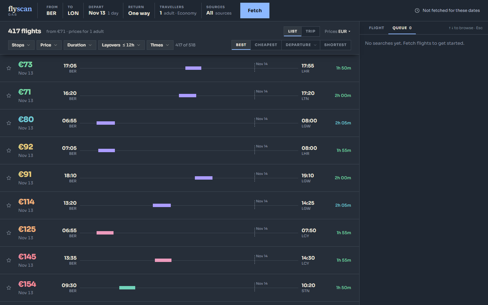
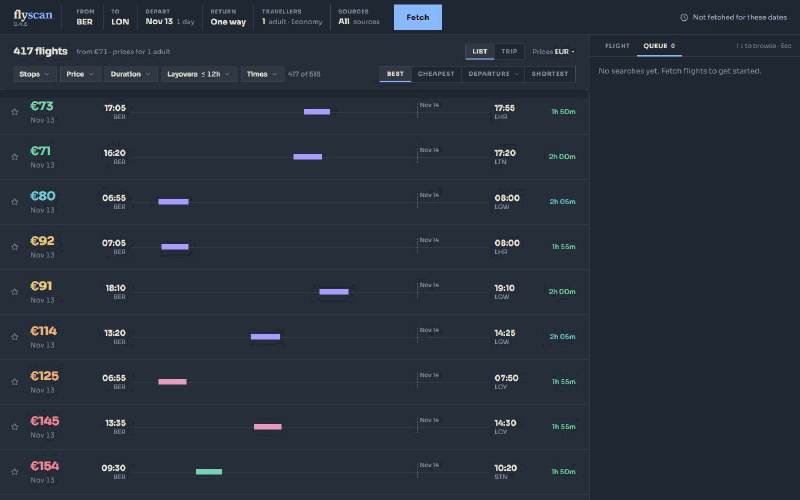
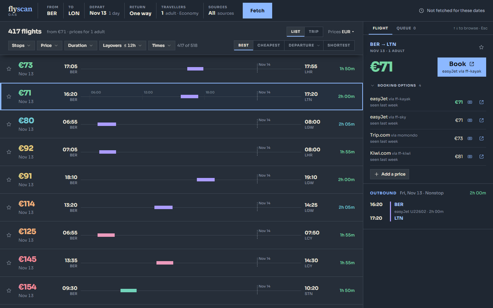
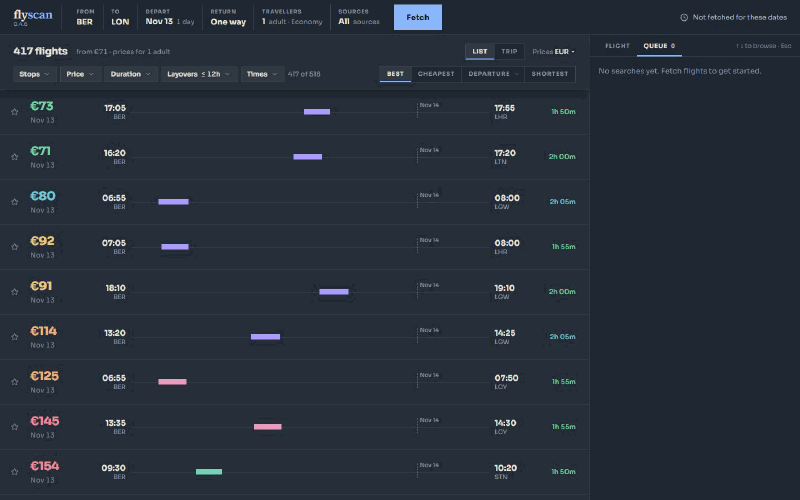
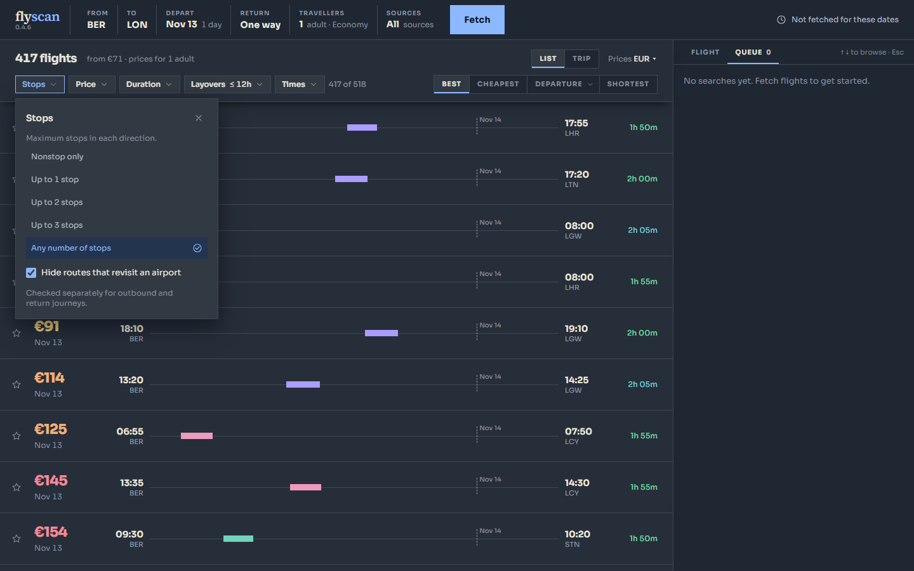

<h1 align="left">
  
</h1>

flyscan searches five flight metasearch sources at once and merges the results into one list with one currency.

**[Open flyscan](https://flyscan.site)** · [Download for Windows, macOS and Linux](https://github.com/santistebanc/flyscan/releases/latest) · [Docs](docs/)



## Features

<table>
<tr>
<td width="50%"></td>
<td><b>One row per flight</b><br>The same flight sold by different sellers becomes one row with every price.</td>
</tr>
<tr>
<td width="50%"></td>
<td><b>Booking options</b><br>Each flight lists its legs, layovers and every seller, with a link to book.</td>
</tr>
<tr>
<td width="50%"></td>
<td><b>Filter and sort</b><br>Stops, price, duration, layovers and times; sort by best, cheapest, departure or shortest.</td>
</tr>
<tr>
<td width="50%"></td>
<td><b>Reads are free</b><br>Results come from a local store; the sources are asked again only on <b>Fetch</b>.</td>
</tr>
</table>

Sources: Kayak, Skyscanner and Kiwi through FlightsFinder, Momondo, and Jetradar. The web app leaves out Kayak and Momondo; see [packaging/RELEASES.md](packaging/RELEASES.md).

## Quick start

```sh
git clone https://github.com/santistebanc/flyscan.git
cd flyscan
uv sync                           # curl_cffi transport dependencies
npm ci --prefix backend
npm run build --prefix backend    # Node.js 22.13+
./dev.sh                          # → http://localhost:1420
```

Development runs offline by default: no flight site is contacted until the owner decides to. See [Using flyscan](docs/usage.md) for the CLI.

## How it's built

- **Frontend:** one React and TypeScript app in `desktop/`, used by the Tauri desktop app and served on the web.
- **Backend:** Node.js with a shared, rate-limited search queue; results stream in as each source answers.
- **Sources:** plain HTTP requests through a curl_cffi transport; a browser opens only for a person to clear a bot check.
- **Storage:** every fetched offer goes into a local SQLite store, so changing the form answers instantly.
- **Releases:** signed desktop builds with auto-update for Windows, macOS and Linux on x64 and ARM64.

## More

- [Using flyscan](docs/usage.md): install, CLI commands and the price spread between sellers.
- [How it works](docs/how-it-works.md): the sources, cabins, round trips, currency, storage, backend architecture, API, offline tests, packaging and verification.
- [Running the desktop app](desktop/README.md#running-it) on a laptop, on a remote dev server, and as the installed app.
- [Media and capture config](docs/media/), refreshed with the project-showcase capture script.
